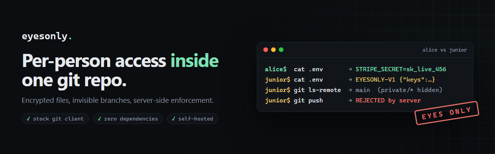
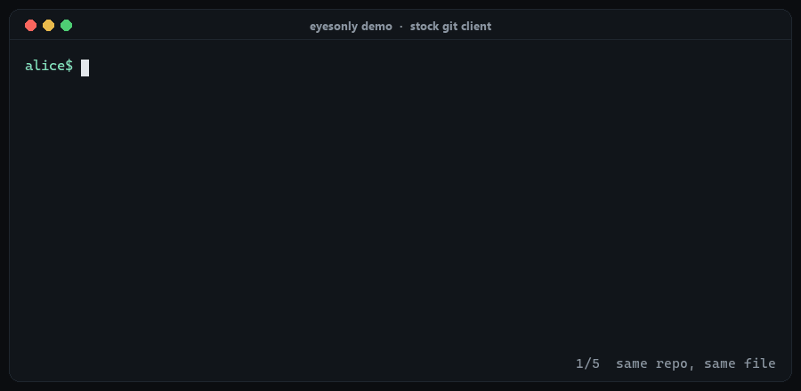

# Eyes Only

[](https://www.npmjs.com/package/eyesonly)
[](https://github.com/jagritvats/eyesonly/actions/workflows/ci.yml)
[](LICENSE)
[](https://github.com/jagritvats/homebrew-tap)



> **Built to be checked.** 1,072 adversarial end-to-end tests (18 suites) run against real repos and a
> real server, the [threat model](THREAT_MODEL.md) maps every attack to the test that stops it,
> and the code is small, dependency-free and open. Found a hole? [Report it](SECURITY.md).

**Private files and built-in secrets in the GitHub repo you already have.** `.env` and
`secrets/**` are encrypted for the people the policy names, and everyone keeps the stock `git`
client. Private branches work too, sealed on the host. No server needed to start; add the
Eyes Only server when private branches must be invisible and plaintext pushes rejected before
they're stored. Zero runtime dependencies (Node ≥ 22 + git).

```
alice$ cat .env          →  STRIPE_SECRET=sk_live_456
junior$ cat .env         →  EYESONLY-V1 {"path":".env","keys":{"alice":…}}
junior$ git push         →  [eyesonly] REJECTED: '.env' ... is NOT encrypted   (pre-push, CI or server)
junior$ git ls-remote    →  main            (private/launch is invisible, with the server)
```

## Why

Git access is all-or-nothing: whoever can clone a repo sees every file and every branch.
So `.env` files travel over Slack, the three-person launch branch lives in a separate repo,
and the contractor fixing a button gets the production keys. Eyes Only adds per-person
access to files and branches in the same repo, without a new VCS or client.

## Try it in 30 seconds



```bash
npx eyesonly demo      # temp dir, local server, alice vs junior; needs git, bash and curl
```

The demo runs the full server story on your machine: alice reads `.env` and junior gets
ciphertext; junior can't list, fetch (even by SHA over protocol v2) or push to `private/*`;
his plaintext push is rejected; and alice's accidental merge of private history into `main`
is rejected while a squash merge goes through.

## Install

```bash
npm i -g eyesonly                      # https://www.npmjs.com/package/eyesonly · CLIs: eyesonly (also `git eyesonly`), eyesonly-server
brew install jagritvats/tap/eyesonly   # macOS / Linux, same CLIs
```

Client and server run on Linux, macOS and Windows (Git for Windows); CI runs every suite
and the demo on all three.

## Quickstart: GitHub mode (no server)

Works on any repo on GitHub, GitLab, Gitea or a bare repo over SSH. The policy lives in the
repo as `.eyesonly/policy.json`, signed by an admin.

```bash
# admin, in the repo you already have
eyesonly keygen alice
eyesonly init --commit         # encrypts .env and secrets/** for @core; prints your admin fingerprint
git push

# each teammate
eyesonly keygen bob
eyesonly clone git@github.com:acme/app.git && cd app     # or: git clone + eyesonly setup
eyesonly join                  # writes .eyesonly/requests/bob.pub: commit it in a pull request

# admin, once the request is merged
eyesonly grant bob --from-request && git add .eyesonly && git commit -m "eyesonly: grant bob"
eyesonly rekey && git commit -am "rekey for bob" && git push

# bob
git pull && eyesonly pull-policy   # .env is now plaintext for bob, ciphertext for everyone else
```

Then make `eyesonly verify` a required check so nothing unverified merges into `main`
([workflow](docs/examples/eyesonly-verify.yml), no secrets needed). `eyesonly setup` also
installs a pre-push hook that runs the same check on every laptop with the client.
Full guide: [GitHub mode](docs/github-mode.md).

## Upgrade: the Eyes Only server

The server sits in front of your repos (GitHub can stay as a mirror for PRs and CI) and turns
detection into prevention: plaintext and unauthorized pushes are rejected before they're
stored, and private branches are invisible to non-members.

```bash
# server, once (behind TLS; or `docker compose up -d` with deploy/ for automatic HTTPS)
export EYESONLY_DATA=/srv/eyesonly
eyesonly keygen alice            # the admin's own identity
eyesonly-server init --admin "$(eyesonly whoami | tail -1)" --repo app.git --url https://git.example.com
eyesonly-server serve --port 8787   # init printed alice's token and the next commands

# move an existing repo onto it (GitHub stays as a second remote)
git remote rename origin github
git remote add origin https://alice:<token>@git.example.com/app.git
git push -u origin --all && git push origin --tags
eyesonly setup && git add .gitattributes && git commit -m "eyesonly" && git push

# teammate with an existing clone: pull first, then setup
git remote set-url origin https://bob:<token>@git.example.com/app.git
git pull && eyesonly setup
```

Secrets already committed in plaintext? The server rejects that history; see
[existing repos and clones](docs/existing-repos.md). Coming from GitHub mode? See
[choosing a mode](docs/choosing-a-mode.md#move-from-github-mode-to-the-server).
**[Read the guides →](https://jagritvats.github.io/eyesonly/docs/)**

## GitHub mode vs server

| | GitHub mode | Server |
|---|---|---|
| Files encrypted per reader (the host can't read them either) | ✓ | ✓ |
| Readers reject forged or unauthorized secrets | ✓ | ✓ |
| Signed policy: no loosening on a branch, no rollback | ✓ | ✓ (sign it) |
| Plaintext push from a laptop with the client | blocked (pre-push hook) | rejected |
| Plaintext push from someone without the client | caught by CI; already visible to repo readers | rejected before it's stored |
| Who changed a secret | the envelope's signer | the authenticated pusher |
| Private branches | sealed: name, commits and author encrypted on the host | invisible to non-members |
| Something to run | nothing | one small Node service |

Same commands in both. The mode is detected per clone, and a remote that is an Eyes Only
server always wins. Details: [choosing a mode](docs/choosing-a-mode.md).

## Day to day

It's just git. `git diff` and `git log -p` show plaintext to people who can read a file, and
`[eyesonly: encrypted, readable by …]` to everyone else. `git mv` of a secret just works: the
pre-commit hook re-seals it for its new path.

| Command | What it does |
|---|---|
| `eyesonly status` | Protected files, who can read them, and whether they need a rekey |
| `eyesonly doctor` | Checks identity, remote, policy, filters and hooks; prints a fix for each problem |
| `eyesonly pull-policy && eyesonly rekey` | After access changes: refresh the policy and re-encrypt for the new audience |
| `eyesonly run -- <cmd>` | Run a command with your protected `.env` files as environment variables, decrypted from the committed blobs (`--file .env.production` to pick one; `eyesonly env` prints them) |
| `eyesonly offboard <user>` | Remove someone, re-encrypt, and write a rotation checklist (key names only) |
| `eyesonly audit <user>` · `audit --file .env --at 2026-03-01` | Every version someone could decrypt; who could read a file on a given date |
| `eyesonly rotate .env KEY=value` | Set dotenv keys in a protected file and stage it encrypted (`--from-stdin` keeps values out of shell history) |
| `eyesonly init` · `join` · `grant` · `revoke` · `policy show` | GitHub mode: start, ask for access, give or remove it, see who can read what |
| `eyesonly grant <name> --read-only` · `--writer` | GitHub mode: read without write (`writers`), or undo it |
| `eyesonly verify [--require-signed]` | GitHub mode: check commits like the server would (pre-push hook and CI); `--require-signed` also attributes changes to SSH commit signers (`grant <name> --ssh-signing-key`) |
| `eyesonly migrate --to <server-url>` | Move a GitHub-mode repo onto a server after `eyesonly-server import`; pinned admin keys carry over |
| `eyesonly whoami` | Your card, key fingerprint and admin-pin fingerprint (`EYESONLY_PIN_ADMIN`) |
| `eyesonly branch push` · `pull` · `list` · `publish` · `delete` | GitHub mode: private branches (e.g. `private/*`) sealed on the host, squash-published when they ship ([guide](docs/github-mode.md#private-branches)) |
| `eyesonly setup --remote <name>` | Use a remote other than `origin` (remembered) |
| `eyesonly identity move --to keychain` | Keep your private key in the OS keychain (macOS Keychain, Windows DPAPI, Linux Secret Service) instead of a file; `identity show` says where it is |
| `EYESONLY_IDENTITY` | Your identity JSON (or base64 of it) from the environment, for CI and containers ([CI guide](docs/ci.md)) |
| `eyesonly-server init` · `user add` · `user set-key` · `policy set` | Server: bootstrap, users, keys, policy ([deployment](docs/server-deployment.md)) |
| `eyesonly-server import <repo.git> --policy .eyesonly/policy.json` | Server: create a repo from a GitHub-mode policy (members, keys, rules) ([moving](docs/choosing-a-mode.md#move-from-github-mode-to-the-server)) |
| `eyesonly admin --server <url> ...` | Server, from your machine: users, repos, grant/revoke, re-sign the policy over HTTPS with an admin token ([admin API](docs/admin-api.md)) |
| `eyesonly-server audit-log [--verify]` | Server: who pushed, fetched, failed to log in or changed what, in a hash-chained log ([deployment](docs/server-deployment.md#audit-log)) |

## Guides

Also at [jagritvats.github.io/eyesonly/docs](https://jagritvats.github.io/eyesonly/docs/).

- [GitHub mode](docs/github-mode.md): encrypted secrets in your GitHub repo, no server
- [Choosing a mode](docs/choosing-a-mode.md): what each mode guarantees, and moving to the server
- [Existing repos and clones](docs/existing-repos.md): add Eyes Only to a repo you have, onboard clones
- [Team workflows](docs/team-workflows.md): grant and revoke access, private branches, offboarding
- [CI](docs/ci.md): `eyesonly verify` as a required check, reading secrets in CI
- [Server deployment](docs/server-deployment.md): TLS, systemd, Docker, backups, audit log
- [Admin API](docs/admin-api.md): manage the server from your machine with `eyesonly admin`
- [Policy reference](docs/policy-reference.md): every policy field
- [Troubleshooting](docs/troubleshooting.md): error messages and fixes

The sections below cover the server's deeper features and how it all works.

## Protected refs and read-only members (server)

Every git host has branch protection; so does Eyes Only. Both fields are optional:

```json
{ "members": ["*"], "admins": ["alice"],
  "groups":  { "core": ["alice", "bob"], "release": ["alice"] },
  "writers": ["@core", "ci-bot"],
  "protect": { "refs/heads/main": { "push": ["@release"], "force": [], "delete": [] },
               "refs/tags/":      { "force": [], "delete": [] } } }
```

- `writers` (default: `members`): everyone else is read-only. They can clone and fetch,
  but pushes get a 403 from the proxy and `has read-only access` from the hook.
- `protect`: longest prefix wins. A missing `push` means writers; a missing `force` or
  `delete` means admins only. Without a `protect` section, tags and the branch HEAD points
  to (usually `main`) can't be force-pushed or deleted by non-admins. Admins bypass
  `protect`.
- Nobody, admins included, can move a ref to a tree whose secrets are invalid under the
  current policy. For example, force-pushing `main` back to a commit from before `eyesonly rekey`
  is refused with `encrypted to users outside the policy`. Neither field is ever sent to
  clients.

In GitHub mode, use your host's branch protection and a required `eyesonly verify` check.

## Worktrees, LFS and .gitattributes

- **Pinned filter.** `eyesonly setup`, `eyesonly clone` and `eyesonly pull-policy` write the policy's
  `filter=eyesonly` lines into a managed block of `.git/info/attributes` (between
  `# >>> eyesonly (managed) >>>` markers; your own lines there are kept). That file beats every
  in-tree `.gitattributes`, so a teammate's `.env filter=lfs` line or a nested
  `secrets/.gitattributes` can't route your plaintext to git-lfs, even with `--no-verify`
  or an IDE that skips hooks. `eyesonly status` warns if a protected path resolves to any other
  filter, and the pre-commit hook refuses it.
- **Server and `eyesonly verify`.** Commits that make a protected path resolve to another
  filter (`filter=lfs`, `-filter`, `!filter`, macros, nested files) are rejected. On the
  server only admins may set LFS endpoints in `.lfsconfig` (`lfs.url`, `remote.*.lfsurl`,
  `url.*.insteadOf`); `eyesonly verify` rejects any such change, since it can't tell who made
  it. This check needs git >= 2.40.
- **Worktrees.** `git worktree add` just works: eyesonly keeps its policy and pinned admin key
  in the main repo's git dir, shared by every worktree. State left in
  `.git/worktrees/<n>/eyesonly` by older versions is moved on the first eyesonly command; if it
  holds a different `trust.json`, eyesonly stops and asks you to delete one.
- **Sparse checkouts.** `eyesonly setup` leaves paths excluded by `git sparse-checkout` alone.

## Merging protected files

Every seal produces fresh ciphertext, so without help any two concurrent edits to `.env`
would conflict inside the envelope. `eyesonly setup` and `eyesonly clone` register a merge driver
(`merge=eyesonly` in `.gitattributes`; older `filter=eyesonly diff=eyesonly` lines are upgraded in
place). On `git merge`, `git rebase` or `git pull` it:

1. verifies all three sides (signed by an allowed writer, bound to this path) and refuses
   forged or moved envelopes, so a merge can't launder them under your signature;
2. decrypts them into private temp files (`.git/eyesonly/tmp`, removed right after) and runs
   `git merge-file`;
3. clean merge: re-seals the result for the file's audience, signed by you. Conflict: the
   working file holds plaintext with conflict markers; fix it and `git add` re-encrypts it.

If you can't read the file you get `you are not a reader` plus the list of readers; pick a
side with `git checkout --ours/--theirs -- <path>`. Binary protected files aren't merged
(pick a side). A modify/delete conflict never reaches the driver; git reports it as usual.

## Mirroring to GitHub/GitLab (server)

Keep private branches and the secrets policy in Eyes Only and still get PRs and CI on
GitHub, GitLab or Gitea: `eyesonly-server mirror` pushes **verified public refs only**.

```bash
install -m 600 /dev/stdin /etc/eyesonly/gh-token <<<"$GITHUB_TOKEN"   # outside the repo dir
eyesonly-server mirror set app.git --url https://github.com/acme/app.git \
  --push refs/heads/main 'refs/tags/v*' --credential-file /etc/eyesonly/gh-token
eyesonly-server mirror push app.git        # run by hand or from cron; non-zero exit on any problem
eyesonly-server mirror show app.git        # config (credential path only) + what was mirrored
```

- Only allowlisted refs that are public under the *current* policy are pushed;
  `refs/heads/private/*` never is, and `refs/*` is refused as too broad.
- The push comes from a staging repo (`<repo>.git/eyesonly-mirror-stage.git`) that only ever
  fetched those refs, so private objects can't ride along as delta bases. Before
  anything is pushed, every new commit is re-checked: protected files must be valid,
  authorized envelopes and no history may come from a private branch. Any failure
  pushes nothing.
- Refspecs are explicit; there's no force unless `--allow-force` (and even then with a
  lease, so upstream changes are never clobbered). `--delete-upstream on-private`
  removes refs upstream when the policy makes them private. Either way, treat what was
  already mirrored as disclosed.
- URLs must be `https://`, `ssh://` or `git@host:path` (`ext::` and friends are always
  refused; local paths need `--allow-local`). The token goes in an HTTP header via the
  environment, never in argv or the URL.
- **Required:** turn on upstream branch protection so only the mirror's credential can
  push the mirrored branches. Eyes Only can't police pushes made directly to GitHub/GitLab.

## How it works

**In both modes:**

1. **Client filter** (`clean`/`smudge`): protected paths are sealed with AES-256-GCM.
   The key is wrapped per reader with X25519, the envelope is signed with Ed25519, and the
   path is bound into the AAD. Unchanged plaintext reuses the existing ciphertext, so
   there's no diff noise. git runs it as one long-running filter process per command
   (protocol v2, `clean` and `smudge` only, never `delay`), not one process per file.
2. **Signed policy**: who reads and writes which path, plus everyone's public keys, signed by
   an admin. Clients verify it, refuse an older version and pin the admin keys on first use.

**GitHub mode:** the policy is committed as `.eyesonly/policy.json` and read only from the
default branch, so a feature branch can't loosen it. `eyesonly verify` runs the server's
content checks over a commit range, in the pre-push hook and as a required CI check.

**Server mode:**

3. **Proxy** (`eyesonly-server serve`): authenticates tokens, hides refs per user, forces
   protocol v0 (v2 allows fetching hidden commits by SHA, as the test suite shows), and
   serves no dumb HTTP. It also filters fetch negotiation: `have`/`shallow` lines for
   commits the user can't see are dropped, so ACKs don't reveal that a private commit
   exists (request bodies are capped at 10 MiB, `EYESONLY_MAX_UPLOAD_PACK_BODY` to change).
4. **Hook** (pre-receive): enforces the policy on every new commit before it's stored,
   covering plaintext, unauthorized edits, forged/replayed envelopes, stale recipients and
   private history leaking into public branches. Every object a push makes visible must
   have been sent by the pusher or already be visible to that ref's audience, so nobody can
   point a ref at a private commit, tree or blob they only know the SHA of.

**On protocol v2.** Git documents that `transfer.hideRefs` isn't read access control
([gitnamespaces(7), SECURITY](https://git-scm.com/docs/gitnamespaces#_security)): over
protocol v2 a client can ask for any object the server has by SHA. It's easy to miss when
building this kind of proxy. Eyes Only forces v0 with every `allow*SHA1InWant` off and has
tests for both versions.

## What Eyes Only doesn't do

- **Revocation isn't retroactive.** Someone who could read a secret has seen it.
  `eyesonly offboard <user>` re-encrypts and writes the rotation checklist; `eyesonly audit <user>`
  lists every version they could decrypt.
- **File names, sizes and timestamps are visible** to everyone who can read the branch.
  Only the contents are protected.
- **GitHub mode detects; the server prevents.** Without a server, a plaintext push from
  someone who skips the client is visible to repo readers until CI flags it. Rotate it.
- **The server can see private branches.** It never sees protected file plaintext, and a
  signed policy stops it from adding readers, but private refs are ordinary git objects on it.
- **Admin trust is TOFU** unless you pin the admin key up front (`EYESONLY_PIN_ADMIN`).
- **Protocol v0 only, plain HTTP.** Put TLS in front of the server, and a reverse proxy
  (Caddy, nginx) for rate limiting and timeouts; the server has neither built in.
- **Your private key is a plain file by default.** `~/.eyesonly/identity.json` (mode 0600)
  isn't passphrase-protected. `eyesonly keygen <name> --store keychain` (or
  `eyesonly identity move --to keychain`) keeps it in the OS keychain instead: macOS
  Keychain, Windows DPAPI or Linux Secret Service. Malware running as you can still ask the
  keychain for it, as with any keychain secret.
- **jj and other git frontends** work for branches, but they don't run git's clean/smudge
  filters, so encrypted files need the git CLI for now.
- **No third-party audit yet.** Every defense has a test and the code is open; reports go
  through [SECURITY.md](SECURITY.md) and get fixed first.

## Prior art

| | Encrypted files | Plaintext / unauthorized writes | Private branches | Stock git client |
|---|---|---|---|---|
| **Eyes Only, server** | ✓ | rejected before they're stored | ✓ | ✓ |
| **Eyes Only, GitHub mode** | ✓ | pre-push hook + required CI check | — (planned) | ✓ |
| git-crypt, git-secret, sops, transcrypt, dotenvx | ✓ | — (client-side only) | — | ✓ |
| Gerrit | — | — | ✓ ref-level Read ACLs | ✓ (but you adopt Gerrit) |
| Gitolite, Bitbucket | — | — | write-only per branch | ✓ |
| GitHub / GitLab | — | push protection for known secret patterns | — (requested / designed) | ✓ |
| [src-control](https://github.com/git-agentic/src-control) | ✓ | ✓ | ✓ | its own `sc` client |
| [Scrim](https://github.com/Derrickkoko1234/scrim) | planned | push and merge-leak guards; secrets planned | ✓ | ✓ (Postgres-backed server) |

The building blocks aren't new: clean/smudge encryption is git-crypt's idea and ref hiding
is built into git. The difference is a signed, enforced policy: checked by every client and in
CI without a server, and before anything is stored with one.

## Layout

```
bin/eyesonly.mjs, bin/eyesonly-server.mjs   CLIs
examples/demo.sh                    the `eyesonly demo` script
src/crypto.mjs                      envelope format
src/attest.mjs                      signed policy manifests + admin key pinning
src/repo-mode.mjs                   GitHub mode: detection, init/join/grant/revoke, clone/setup
src/repo-policy.mjs                 the signed policy committed as .eyesonly/policy.json
src/verify.mjs, src/validate.mjs    eyesonly verify; content checks shared with the server hook
src/negotiate.mjs                   upload-pack negotiation filter
src/hooks.mjs                       client pre-commit and pre-push hooks
src/policy.mjs                      glob / ref / group matching
src/client.mjs                      filters + developer commands (doctor, --remote)
src/identity.mjs                    where the identity comes from (EYESONLY_IDENTITY or file)
src/run.mjs                         eyesonly run / env (dotenv files into a process env)
src/filterproc.mjs                  long-running filter process (git protocol v2)
src/merge.mjs                       merge driver for protected files
src/refguard.mjs                    protected refs, read-only members, rewind check
src/attrs.mjs                       info/attributes pinning, filter-redirect check
src/mirror.mjs                      outbound mirror to GitHub/GitLab
src/store.mjs                       server state and operations (shared by the admin CLI and API)
src/admin.mjs, src/admin-client.mjs admin API, admin tokens, login backoff; eyesonly admin
src/auditlog.mjs                       hash-chained audit log
src/server.mjs                      admin CLI, HTTP proxy, pre-receive hook
action.yml, action/*.sh             GitHub Action: verify (GitHub mode) or clone + decrypt (server)
test/*.sh                           adversarial suites (npm test runs them all)
site/index.html                     landing page
```
